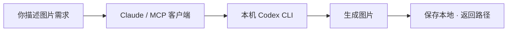

<div align="center">

# Codex Image Bridge

### 让 Claude 也能调用 Codex 生图

描述你想要的图片，让 Claude 调用本机 Codex 完成生成，图片直接保存到本地。

**无需单独配置图片 API Key · 支持参考图 · MCP 接入 · 零 npm 依赖**

[生成效果](#生成效果) · [快速开始](#快速开始) · [其他客户端](#其他客户端) · [常见问题](#常见问题)

</div>

---

## 它能做什么？

写文章需要配图、做网页缺少插画、想把参考图换个风格？接入后，你可以直接在 Claude 中描述需求，让它调用 Codex 生成图片，再将图片用于后续工作。

> 帮我生成一张 9:16 的公众号插画：橘猫坐在窗边，暖色水彩风。使用 codex-image，完成后返回图片路径。



| 你想做的事 | 工具如何配合 |
| :--- | :--- |
| 给文章、封面或网页生成配图 | 用自然语言描述内容、风格和比例 |
| 根据已有图片继续创作 | 传入本地参考图，最多 5 张 |
| 在 Claude 的工作流程中自动生图 | 通过 MCP 提交任务、查询结果、取得图片路径 |
| 从脚本或终端调用 | 命令行运行，完成后输出 JSON 结果 |

沿用本机 Codex 的登录状态，**实际可用性和使用额度取决于你的账号**。

## 生成效果

这张图片来自本项目的一次真实 Codex CLI 调用。提示词：橘猫、奶油色背景、方形插画、无文字。

<div align="center">
  
</div>

## 快速开始

### 1. 准备环境并下载

| 需要 | 要求 |
| :--- | :--- |
| Node.js | 20 或以上 |
| Codex CLI | 已安装，当前账号可使用内置生图工具 |
| MCP 客户端 | Claude Code、Claude Desktop 或其他支持本地 stdio MCP 的工具 |

确保终端能运行 `node` 和 `codex`，然后执行：

```powershell
git clone https://github.com/hushrift/codex_image_gen.git
cd codex_image_gen
codex login
```

无需执行 `npm install`。

### 2. 接入 Claude Code

在需要使用生图工具的项目目录下执行，将示例替换为下载后的 **bridge.mjs 绝对路径**：

```powershell
claude mcp add --transport stdio codex-image -- node "/absolute/path/to/codex_image_gen/bridge.mjs" mcp
```

Windows 路径示例：`C:/tools/codex_image_gen/bridge.mjs`。

### 3. 让 Claude 开始生图

重启 Claude Code，按客户端提示启用服务，然后发送：

> 使用 codex-image 生成一张橘猫插画，奶油色背景，方形构图。提交后每隔约 10 秒查询任务，直到完成或失败，最后返回图片路径。

图片默认保存在 `outputs/<任务ID>/` 中。Claude 可以用自己的图片读取工具打开结果，或继续将图片用于文章、网页等任务。

## 其他客户端

将下面的条目合并到 MCP 配置，替换为实际绝对路径，保留已有服务配置。也可以复制 [.mcp.example.json](.mcp.example.json)。

```json
{
  "mcpServers": {
    "codex-image": {
      "command": "node",
      "args": ["/absolute/path/to/codex_image_gen/bridge.mjs", "mcp"]
    }
  }
}
```

发送文件夹地址不会自动完成接入，需要客户端加载 MCP 配置。Claude 网页版无法仅通过本地路径调用本服务。

## 命令行调用

```powershell
# 文生图
node bridge.mjs generate "一只橘猫，奶油色背景，方形插画"

# 参考图编辑
node bridge.mjs generate "将参考图改成水彩风格" "C:/images/reference.png"

# 查询已有任务
node bridge.mjs status "任务ID"
```

`generate` 会等待任务完成，输出 JSON；失败时返回非零退出码。

## MCP 工具

| 工具 | 输入 | 返回结果 |
| :--- | :--- | :--- |
| `generate_image` | `prompt`，可选 `references` | 立即返回任务 ID |
| `get_image_job` | 任务 `id` | `running` / `completed` / `failed`，以及图片路径或错误信息 |

<details>
<summary>查看参数示例</summary>

```json
{
  "prompt": "橘猫坐在窗边，暖色水彩，9:16",
  "references": ["C:/images/reference.png"]
}
```

`references` 可省略，最多 5 张，支持 PNG、JPEG、WebP，需使用绝对路径。比例、尺寸、风格和图片中的文字写入 `prompt`，最终尺寸由生图工具决定。成功结果的 `images` 字段返回图片绝对路径列表。

</details>

## 常见问题

<details>
<summary><strong>需要 API Key 吗？会消耗什么额度？</strong></summary>

沿用本机 Codex 登录及配置，不需要额外配置图片 API Key。实际使用受账号额度和工具可用性限制；本工具不会自动切换到单独付费的图片 API。

</details>

<details>
<summary><strong>Claude 找不到 node 或 codex 怎么办？</strong></summary>

将 MCP 配置中的 `command` 改为 Node.js 可执行文件的绝对路径。若找不到 Codex，在 MCP 条目的 `env` 中设置 `CODEX_BIN`，指向 Codex 可执行文件。

Windows 可用 `Get-Command node` 和 `Get-Command codex` 查询安装路径。

</details>

<details>
<summary><strong>生成失败或一直没有图片，去哪里排查？</strong></summary>

查看 `outputs/<任务ID>/` 中的 `result.txt`、`events.jsonl` 和 `stderr.log`。桌面聊天可生图，不代表 CLI 会话一定具备同样能力；没有生成文件时会明确标记为失败。

若 Windows 沙箱无法复制已生成的图片，桥接程序会按本次会话 ID，从 Codex 的 `generated_images` 对应目录收集结果，不扫描其他会话。

</details>

<details>
<summary><strong>任务运行时可以关闭客户端吗？支持远程调用吗？</strong></summary>

MCP 服务需要在生成期间保持运行。重启不会自动恢复或重试任务；跨进程查询旧任务时，状态可能已过期。

本版本通过本地 stdio MCP 调用，返回本地文件路径。客户端和服务需能访问同一文件系统，暂未提供远程 HTTP 接口。

</details>

## 配置与开发

| 环境变量 | 用途 | 默认值 |
| :--- | :--- | :--- |
| `CODEX_BIN` | Codex 可执行文件路径 | 从 PATH 查找 `codex` |
| `CODEX_IMAGE_OUTPUT` | 图片和任务文件的保存目录 | 项目下的 `outputs/` |
| `CODEX_IMAGE_TIMEOUT_MS` | 单次任务超时，单位毫秒 | `600000`（10 分钟） |

每个服务进程最多同时运行两个任务。Codex 在独立任务目录使用 `workspace-write` 沙箱，并禁用交互审批。

任务目录包含提示词、参考图和日志，请按需清理；`outputs/`、本机 `.mcp.json` 和 `.env` 已加入 Git 忽略规则。

```powershell
npm test
```

已验证环境：Windows · Node.js 24 · Codex CLI `0.162.0-alpha.17.2` · ChatGPT 登录。测试覆盖 MCP 握手、工具发现、无效参数及会话图片收集。

调用方式参考 [Codex 非交互模式官方文档](https://developers.openai.com/codex/noninteractive)。
